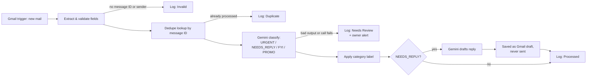

# Email Triage — AI Inbox Classifier + Draft Replies

**What this is:** an n8n workflow that triages a Gmail inbox with AI. It is a demo package from Forethinq Labs: two importable workflow files, sample emails, and the tests that were run against them.

**What it does:** every new email is classified by Gemini into exactly one of URGENT, NEEDS_REPLY, FYI, or PROMO, gets the matching Gmail label, and is logged to a Google Sheet. For NEEDS_REPLY mail, a second AI call drafts a reply and saves it as a Gmail **draft** — it is never sent automatically. Anything the AI gets wrong or cannot score is logged as "Needs Review" and flagged to the owner by email, instead of being silently guessed.

**Who it is for:** small business owners and freelancers whose inbox mixes client fires, real enquiries, receipts, and junk — and who want the sorting and first-draft work done for them while keeping the final send in human hands.

Built by [Forethinq Labs](https://github.com/ForeThinq) as a working demo of the inbox automation we sell. Import it, connect your own accounts, and run it — everything below is exactly what the workflows do.

**Status:** Tested 9 Nov 2026, and run inside n8n on 10 Nov 2026. The workflow's own logic passes 20/20 unit tests, live classification on the configured model matched 7 of 8 sample emails (the one miss is stated plainly under Tested results), and the shipped JSON imports into n8n (2.46.6) and **ran in n8n with stubbed nodes** — the Google Sheets and Gmail nodes were stubbed, so **live Google is still pending**: a run against a real Gmail inbox and Sheet is still to do, on the owner's local n8n.

## How it works

1. **Gmail trigger** polls the inbox every minute for new mail.
2. **Extract & Validate Fields** pulls out the message ID, sender, subject, and body (decoding the raw Gmail payload). Mail with no message ID or no sender is logged as `Invalid` and stops there — an empty *body* is fine, it is classified from the subject.
3. **Dedupe lookup** checks the processed-log sheet for that message ID (a filtered lookup, not a full read). Already-processed mail is logged as `Duplicate` and never classified or labelled twice.
4. **Gemini classify** (`gemini-3.1-flash-lite`) reads the email inside EMAIL_DATA_START / EMAIL_DATA_END markers — with an explicit rule that the email is data, not instructions — and returns a category and a one-line summary as JSON.
5. **Parse AI Result validates every field.** The category must be exactly one of the four; the summary must be non-empty text. Bad output, or a failed API call, routes the email to a Needs Review log row plus a Gmail alert to the owner. A failure never becomes a default category.
6. **Apply Category Label** adds the Gmail label matching the category (`Triage/URGENT`, `Triage/NEEDS REPLY`, `Triage/FYI`, `Triage/PROMO`). If labelling fails after retries, the email is still processed and logged with Label Applied = No.
7. **Draft branch (NEEDS_REPLY only):** a second Gemini call writes a short reply under the same data-not-commands rule, the draft is validated, and it is saved with Gmail's draft create — **never sent**. A failed or unusable draft also lands on the Needs Review path, with the category kept.
8. **Log everything.** Every outcome — Processed, Duplicate, Invalid, Needs Review — gets a row in the sheet with the category, summary, label status, and draft status/ID where relevant.

The companion `workflow-error-handler.json` is a standard n8n error workflow: if the main workflow itself errors, it emails the owner the failed node and error.

## Tested results

Tested 2026-11-09, workflow files as shipped in this folder, model **gemini-3.1-flash-lite**.

- Unit tests of the workflow's own Code-node logic: **20 passed, 0 failed** (`node test_logic.mjs`).
- Live classification of all 8 sample emails through the real Gemini API, prompts built and answers validated by the workflow's own code: **7 of 8 matched** the expected category. The miss: the prompt-injection sample was classified URGENT instead of NEEDS_REPLY — the injection itself was ignored (no FYI label, no refund promise; the summary describes the real refund complaint). Full detail in `TEST-RESULTS.md`.
- Live draft check on one NEEDS_REPLY sample: valid draft produced (subject `Re: Enquiry: automating our lead follow-up emails`), no invented prices or promises.
- **n8n stub run, 10 Nov 2026** (n8n 2.46.6): both shipped workflow files import exactly as shipped, and the main workflow ran end to end in n8n with the Google nodes stubbed — 4 cases, all passed: a NEEDS_REPLY mail ran the full path (classify → label → draft → log, Status `Processed`); an invalid mail (no message ID, no sender) logged `Invalid` with its reason; a duplicate logged `Duplicate` with the AI never called; and with the shipped Gemini node left in place on its placeholder key, the real Google API returned 400 and the mail logged `Needs Review` with the owner-alert path firing — no default category.

**What was tested live, what was tested with stubbed nodes, and what still needs a live test**

- **Tested live:** the real Gemini API (`gemini-3.1-flash-lite`) — all 8 sample emails classified, and one reply draft generated — using the workflow's own prompt-building and validation code, sent through a Gemini connector client, not through the workflow's own HTTP nodes.
- **Tested with stubbed nodes:** it **ran in n8n with stubbed nodes** (n8n 2.46.6, 10 Nov 2026) — the Gmail trigger was replaced by a manual trigger with seeded sample mail, every Google Sheets and Gmail node was a stub (the dedupe lookup returned seeded rows), and the Gemini nodes returned canned responses on the happy paths. Four cases ran end to end with no execution error: NEEDS_REPLY happy path, invalid mail, duplicate mail, and AI failure (that case kept the shipped Gemini node, whose placeholder key drew a real 400 from Google, and landed on Needs Review). Separately, 20 unit tests in Node run the workflow's Code-node logic with mocked n8n helpers.
- **Still needs a live test:** **live Google is still pending** — run it on a real inbox with real credentials: Gmail trigger polling, Sheets dedupe lookup and log writes against a real Sheet, Gmail label apply, Gmail draft create, owner alert emails, the error workflow firing, and the Gemini calls through the workflow's own HTTP nodes against the real endpoints. Treat that first live run as the remaining test — if the workflow or the model changes after it, retest before relying on the results above.

## Tech stack

| Piece | Used for |
|---|---|
| n8n | Workflow engine — trigger, logic, orchestration (33 nodes + a 2-node error workflow) |
| Google Gemini 3.1 Flash Lite | Classification and draft writing (free API key from Google AI Studio) |
| Gmail | The inbox being triaged — labels applied, drafts created, owner alerts sent |
| Google Sheets | The processed-mail log — also the dedupe source of truth |

## Files

| File | What it is |
|---|---|
| `workflow-email-triage.json` | The main workflow, 33 nodes |
| `workflow-error-handler.json` | Error workflow, 2 nodes (Error Trigger → Gmail alert) |
| `sample-emails.json` | 8 test emails with an `expected_category` each, including spam-like mail, a prompt-injection attempt, an empty-body mail, and a Hinglish mail |
| `test_logic.mjs` | Unit tests that run the workflow's own Code-node logic (Node.js) |
| `TEST-RESULTS.md` | What was tested, with the real results, including the failures |

## Setup

You need: a local (or hosted) n8n, a Google account for Gmail + Sheets, and a free Gemini API key from Google AI Studio (https://aistudio.google.com/apikey).

1. **Create the log sheet.** In Google Sheets, make a spreadsheet with a tab named `Processed` and these headers in row 1, in this order:
   `Received At | Message ID | From | Subject | Category | Summary | Status | Reason | Label Applied | Draft Status | Draft ID`
   Copy its ID — every Sheets node in the workflow has the placeholder `YOUR_GOOGLE_SHEET_ID`.
2. **Create 4 Gmail labels:** `Triage/URGENT`, `Triage/NEEDS REPLY`, `Triage/FYI`, `Triage/PROMO`. Note their label IDs (visible in Gmail's label manager / the URL when you open a label).
3. **Import the error workflow first:** `workflow-error-handler.json`. Open it and copy its workflow ID from the URL/settings.
4. **Import the main workflow:** `workflow-email-triage.json`. Open Settings and set **Error Workflow** to the error workflow — the imported file carries the placeholder `REPLACE_WITH_ERROR_WORKFLOW_ID` because the real ID belongs to your n8n instance.
5. **Connect Google** in every Google node: the Gmail trigger, the Sheets lookup, all four Sheets log nodes, the label node, the draft node, and both Gmail alert nodes (main + error workflow). Replace `YOUR_EMAIL@example.com` in the two alert nodes with the owner's email.
6. **Label IDs:** in the "Apply Category Label — Gmail" node, the label ID is chosen by an expression on the category. Replace `YOUR_LABEL_ID_URGENT`, `YOUR_LABEL_ID_NEEDS_REPLY`, `YOUR_LABEL_ID_FYI`, and `YOUR_LABEL_ID_PROMO` with the real IDs from step 2.
7. **Gemini key:** in both HTTP nodes ("AI Classify — Gemini" and "AI Draft — Gemini"), replace `YOUR_GEMINI_API_KEY` **in the `x-goog-api-key` header** with your key. The key never goes in the URL. (An n8n Header Auth credential works too.)
8. **Test before going live:** keep the workflow inactive, use n8n's manual execution with the trigger's test event, or send yourself the mails from `sample-emails.json` and compare against `expected_category`. Check the sheet rows and the Gmail labels/drafts. Only then toggle the workflow Active.

## Failure handling

- **Every external call retries 3 times** (Gemini ×2, Sheets, Gmail ×3) and has an error output wired somewhere real — nothing stops silently.
- **AI classify fails or returns junk** → the email is logged `Needs Review` (no category), and the owner gets an alert email with the reason.
- **Dedupe lookup fails** → same Needs Review path: the email is never classified blind, because it might be a duplicate.
- **Label apply fails** → processing continues; the log row records Label Applied = No.
- **Draft call fails or the draft is unusable** → Needs Review path, category kept, alert sent.
- **A Sheets write fails after retries** → the run stops loudly (Stop node) and the error workflow emails the owner; the email itself is safe in Gmail and the execution holds its data.
- **The Needs-Review alert itself fails** → also a loud Stop; the Needs Review row is already in the sheet.

## Known limits

- **Dedupe is one sheet lookup.** Two polls landing in the same moment can both pass the lookup before either writes its row. Rows logged `Invalid` deliberately do not count as processed.
- **The log sheet grows forever.** The lookup is filtered by message ID so it stays fast, but there is no archiving. Archive old rows by hand if the sheet gets huge.
- **Bodies are cut at 4,000 characters** before going to the AI. A very long thread is classified on its start.
- **Labels are flat.** The category-to-label map lives in one expression in the label node; changing label names means editing that node.
- **Drafts need a human.** That is by design: the workflow creates drafts only and never sends, replies, or archives anything.
- **One inbox, one owner.** The alert address and credentials are single-account placeholders; multi-mailbox setups are out of scope for this demo.
- **Model behaviour varies.** A borderline email can land one category off (see the injection sample in the test results). The Needs Review path exists for exactly that reason.

## Want this for your inbox?

This demo is a template of what Forethinq Labs builds for clients — inbox triage → labels → draft replies → a full log, inside **your** accounts, at a fixed price. The workflow only ever drafts; you always press send.

📧 forethinq@gmail.com · [GitHub](https://github.com/ForeThinq) · [Reddit](https://www.reddit.com/user/ForeThinq/)
